# Architecture

Project: `agentic-llm-sft-rlvr-synthetic-data-benchmark-rnd-lab`

```mermaid
flowchart TD
  n0["Project ingress → domain-llm-fine-tuning-05d1e392"]
  n1["Domain LLM fine-tuning with LoRA/SFT and dialogue/tool-call training formats"]
  n2["domain-llm-fine-tuning-05d1e392 → scientifically-rigorous-2d3b54ba contract adapter"]
  n3["Scientifically rigorous hypothesis formulation, controlled experiments and statistical comparison"]
  n4["scientifically-rigorous-2d3b54ba → synthetic-agent-data-ge-5456d7a2 contract adapter"]
  n5["Synthetic agent-data generation pipeline: task generation, agent rollout, automatic verification, filtering and dataset assembly"]
  n6["synthetic-agent-data-ge-5456d7a2 → agentic-benchmark-harne-b447fbac contract adapter"]
  n7["Agentic benchmark harness with deterministic oracles, tests and domain-specific scoring for code, SQL and tool-use trajectories"]
  n8["agentic-benchmark-harne-b447fbac → sql-agent-tasks-and-exe-31fdd585 contract adapter"]
  n9["SQL-agent tasks and executable database oracles for generated benchmarks"]
  n10["sql-agent-tasks-and-exe-31fdd585 → synthetic-training-eval-00c1d43f contract adapter"]
  n11["Synthetic training/evaluation dataset quality controls, deduplication, contamination checks and failure-oriented filtering"]
  n12["synthetic-training-eval-00c1d43f → project-owned-end-to-en-f490927d contract adapter"]
  n13["Project-owned end-to-end integration, reproducible runtime, experiment artifacts and local service interface"]
  n0 --> n1
  n1 --> n2
  n2 --> n3
  n3 --> n4
  n4 --> n5
  n5 --> n6
  n6 --> n7
  n7 --> n8
  n8 --> n9
  n9 --> n10
  n10 --> n11
  n11 --> n12
  n12 --> n13
```

## Execution semantics

The graph expresses architectural contract bindings. The runtime receipt for each node records the actual input source used in that run (`SMOKE_FIXTURE`, `UPSTREAM_OUTPUT`, reuse binding, etc.), so the UI does not pretend that every architectural edge is a literal payload transfer.
